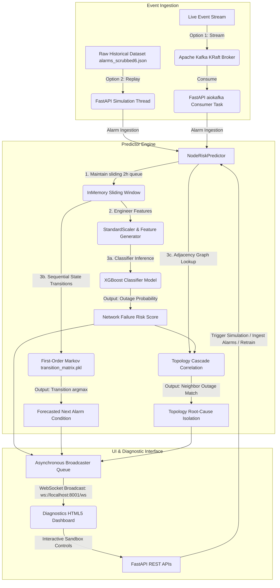

# 📡 AlarmIQ: Telecom Alarm Intelligence System

AlarmIQ is an enterprise-grade, real-time diagnostic and early-warning intelligence system for telecommunication networks. It processes large-scale, high-velocity network events to forecast imminent node failures up to 2 hours before they occur, identify the specific alarm condition that will trigger next, and isolate the root cause using spatial topology correlation.

By shifting network operations from reactive troubleshooting to proactive self-healing, AlarmIQ enables operators to prevent catastrophic outages, minimize Mean Time to Resolution (MTTR), and optimize service availability.

---

## 🏗 System Architecture

AlarmIQ is built upon a decoupled, low-latency asynchronous architecture designed to handle thousands of events per second without thread blocking or starvation.



### Key Technical Components:
*   **FastAPI Asynchronous Backend (`backend/main.py`)**: Manages the event loop, handles HTTP REST APIs, and coordinates real-time full-duplex WebSocket connections via a `ConnManager`.
*   **Background Simulation Thread**: Replays over **296,000 historical telecom alarms** chronologically. By decoupling the CPU-bound ML scoring inside a dedicated OS thread, the main event loop remains free from GIL (Global Interpreter Lock) starvation, guaranteeing a responsive UI.
*   **Apache Kafka Integration (`backend/kafka_producer.py` & `main.py`)**: Uses a single-node, zookeeperless KRaft Apache Kafka broker (`apache/kafka:3.7.0`) to stream and ingest telecom events asynchronously in real-time using `aiokafka`.
*   **Decoupled Frontend (`backend/dashboard.html`)**: A glassmorphic, real-time diagnostic dashboard that renders active warnings, live network topologies, sequence forecasts, and a live prediction validation ledger.

---

## 🧮 Mathematical & Machine Learning Concepts

AlarmIQ combines temporal feature engineering, advanced gradient boosting classifiers, stochastic sequence modeling (Markov chains), spatial network topology graphs, and real-time validation ledgers.

---

### 1. Sliding Window Feature Engineering (Temporal Outage Representation)
Raw network events are highly sparse and state-based. To build input vectors for machine learning, the system tracks a rolling **2-hour temporal lookback window** ($T_{\text{lookback}} = 2\text{ hours}$) for every network device (node). 

When a new alarm is ingested, a feature vector is generated on the fly containing the following metrics:

#### Severity Escalation Score
Outages are rarely sudden; they are preceded by a cascade of minor errors that transition into critical failures. The system computes a weighted average of the alarm severities inside the window, applying higher weights to more recent events chronologically.

$$S_{\text{escalation}} = \frac{\sum_{i=1}^{N} w(s_i) \cdot i}{\frac{N(N+1)}{2}}$$

Where:
*   $N$ is the total number of alarms present in the node's current 2-hour window.
*   $s_i$ is the chronological severity of the $i$-th alarm in the window ($i = 1$ is the oldest, $i = N$ is the newest).
*   $w(s_i)$ is a pre-defined static severity mapping:
    $$\text{CRITICAL} \mapsto 4, \quad \text{MAJOR} \mapsto 3, \quad \text{WARNING} \mapsto 2, \quad \text{MINOR} \mapsto 1, \quad \text{CLEARED} \mapsto 0$$
*   The denominator $\frac{N(N+1)}{2}$ represents the sum of the chronological weights (the arithmetic series $\sum_{i=1}^{N} i$), normalizing the score between $0.0$ and $4.0$.

#### Alarm Density
Measures the average frequency and temporal concentration of network events. It is defined as the mean interval (in minutes) between consecutive alarms in the sliding window.

$$D_{\text{density}} = \frac{1}{N - 1} \sum_{j=2}^{N} \left( t_j - t_{j-1} \right)$$

Where $t_j$ represents the timestamp (in minutes) of the $j$-th chronological event in the window. A small density value indicates high-frequency alarm bursts, which are highly correlated with immediate protocol collapse.

---

### 2. Smart Time-Based Sampling & Balanced Labeling
Outages are highly sparse in stable enterprise networks. An exhaustive hourly sliding-window sampling across a 2-year timeline would result in extreme class imbalance ($>99.9\%$ negative class), leading to highly biased models. AlarmIQ resolves this using a **Smart Sampling Strategy**:

```
OUTAGE TIMELINE:
───[Quiet Period]───────[Pre-Failure Period (2h)]───🔴 OUTAGE EVENT (>=3 CRITICAL Alarms / 30m)
           │                        │
           ▼                        ▼
    NEGATIVE SAMPLES         POSITIVE SAMPLES
    (Randomly selected       (Sampled at T - 30m,
     from quiet periods)      T - 1h, T - 1.5h, T - 2h)
```

1.  **Failure Event Definition**: A node failure is mathematically defined as a cluster containing $\ge 3$ `CRITICAL` alarms occurring within a 30-minute interval ($W_{\text{failure}} = 30\text{ min}$).
2.  **Positive Samples ($y = 1$)**: Engineered windows are extracted at exactly 30 minutes, 1 hour, 1.5 hours, and 2 hours preceding a failure event. This teaches the classifier to recognize the exact *pre-failure temporal patterns*.
3.  **Negative Samples ($y = 0$)**: Safe/stable windows are sampled randomly from "quiet periods"—defined as timestamps located at least $\pm 4$ hours away from *any* historical failure event.
4.  **Imbalance Mitigation (SMOTE)**: Standard scaling is applied using `StandardScaler` to transform all feature values into standard normal distributions ($z = \frac{x - \mu}{\sigma}$). If minority class samples are scarce in the training split, Synthetic Minority Over-sampling Technique (SMOTE) is applied. SMOTE synthetically creates new minority samples by interpolating between nearest neighbors:
    $$\vec{x}_{\text{new}} = \vec{x}_i + \lambda \left( \vec{x}_{zi} - \vec{x}_i \right), \quad \lambda \sim \mathcal{U}(0, 1)$$

---

### 3. Chronological Train-Test Split (Preventing Data Leakage)
Traditional random $k$-fold cross-validation is highly flawed for time-series data as it introduces **temporal data leakage** (using future telemetry to predict past failures). AlarmIQ enforces a strict chronological split based on the end-of-window timestamp:

```
CHRONOLOGICAL DATASET:
[======================= TRAINING SET =======================] [=============== TESTING SET ===============]
0%                                                       Split Index (e.g. 20%)                          100%
```

All data is sorted by `window_end` chronologically. The first fraction (e.g., 20%) is allocated to training, and the remainder (e.g., 80%) is reserved for testing. This evaluates the models on their capacity to forecast outages in simulated "future" time steps.

---

### 4. Classifier Model Candidates & Evaluation Metrics
The pipeline trains and evaluates three distinct machine learning algorithms:
1.  **Logistic Regression (Baseline)**: A linear model using the sigmoid function:
    $$P(y=1|\vec{x}) = \sigma(\vec{w}^T \vec{x} + b) = \frac{1}{1 + e^{-(\vec{w}^T \vec{x} + b)}}$$
2.  **Random Forest Classifier**: An ensemble of bagged decision trees with a `balanced` class-weight penalty.
3.  **XGBoost (Extreme Gradient Boosting)**: A gradient-boosted decision tree ensemble using a regularized objective function and custom class weights (`scale_pos_weight`) to penalize minority misclassifications mathematically:
    $$\mathcal{L}(\phi) = \sum_{i} l(y_i, \hat{y}_i) + \sum_{k} \Omega(f_k)$$

#### Primary Evaluation Metrics
*   **ROC-AUC**: Evaluates model discrimination across all decision thresholds.
*   **Average Precision (PR-AUC)**: Evaluates the precision-recall trade-off. This metric is far more robust than ROC-AUC for imbalanced data, as it does not include the True Negatives in its formulation.
    $$\text{Average Precision (AP)} = \sum_{n} (R_n - R_{n-1}) P_n$$

---

### 5. Sequence Forecasting via First-Order Markov Chains
While the classifier calculates *whether* an outage is imminent, it cannot identify *which* specific event type will trigger it. AlarmIQ implements a **Sequence Forecasting Engine** based on a First-Order Markov chain model of network event transitions.

```
       Current State (S_t)               Transition Probabilities               Next State (S_{t+1})
   ┌──────────────────────────┐           ┌────────────────────┐            ┌──────────────────────────┐
   │                          │ ➜ (0.45)  │ LINK_DOWN          │ ➜ (45%)    │                          │
   │ cefcPowerStatusChange    │ ➜ (0.35)  │ cefcFRURemoved     │ ➜ (35%)    │    Forecasted Condition  │
   │                          │ ➜ (0.20)  │ Other Conditions   │ ➜ (20%)    │                          │
   └──────────────────────────┘           └────────────────────┘            └──────────────────────────┘
```

#### Markov Property
The probability distribution of the next alarm condition $S_{t+1}$ is assumed to depend strictly on the current alarm condition $S_t$ and is conditionally independent of all preceding history:

$$P(S_{t+1} = s_j \mid S_t = s_i, S_{t-1} = s_k, \dots, S_0 = s_0) = P(S_{t+1} = s_j \mid S_t = s_i)$$

#### Transition Probability Matrix Construction
1.  **Deduplication**: Consecutive identical alarm conditions are collapsed (e.g., `LINK_DOWN` followed immediately by `LINK_DOWN` is treated as a single state) to isolate cross-state causal progressions.
2.  **Maximum Likelihood Estimation**: The transition probability $P_{ij}$ from state $s_i$ to $s_j$ is calculated by:
    $$P_{ij} = P(S_{t+1} = s_j \mid S_t = s_i) = \frac{C(s_i \rightarrow s_j)}{\sum_{k} C(s_i \rightarrow s_k)}$$
    Where $C(s_i \rightarrow s_j)$ is the historical count of transitions from condition $s_i$ directly to condition $s_j$.
3.  **Inference**: Given a current alarm condition $s_i$ on a node, the system forecasts the next condition $s^*$ using:
    $$s^* = \underset{s_j}{\operatorname{argmax}} \, P_{ij}$$
    The transition matrix is saved to `models/transition_matrix.pkl` and evaluates per-node transition models first, falling back to a global transition model if data is sparse.

---

### 6. Spatial Network Topology Graph Correlation
Outages in telecom networks often cascade across physical and logical lines (e.g., a central router collapse triggers adjacent edge routers to drop their border gateway protocol link adjacencies). 

AlarmIQ models the network topology as an undirected graph $\mathcal{G} = (\mathcal{V}, \mathcal{E})$:

```
            [host-er2-router-02] ─── [host-er2-router-03] ─── [demo-node-01]
                     │                       │
                     └─────────────── [host-er2-router-01] ─── [host-pe1-router-01] ─── [host-pe1-router-02]
```

When node $u \in \mathcal{V}$ registers protocol failure alarms (such as `BGP-5-ADJCHANGE_DOWN` or `LINK_DOWN`) and its risk score crosses into the `HIGH` or `CRITICAL` threshold, the system queries its topological neighbors:

$$\mathcal{N}(u) = \{ v \in \mathcal{V} \mid (u, v) \in \mathcal{E} \}$$

If any neighbor $v \in \mathcal{N}(u)$ is currently down in a `HIGH` or `CRITICAL` risk state, the system isolates $v$ as the probable **root cause**, logging a correlation event.

---

### 7. Real-Time Prediction Verification Ledger (Precision Tracking)
To ensure system transparency, AlarmIQ implements a continuous **Verification Ledger**. The system monitors predictions in real-time, verifying their outcomes.

```
                  ┌──────────────────────┐
                  │ Outage Risk >= 50%   │
                  └──────────┬───────────┘
                             │ Opens Pending Prediction
                             ▼
               ┌───────────────────────────┐
               │    2-Hour Horizon Clock   │
               └──────┬─────────────┬──────┘
                      │             │
        Failure Occurs│             │Horizon Expires
        (>=3 Critical │             │With No Outages
        in 30 minutes)│             │
                      ▼             ▼
          ┌──────────────┐       ┌───────────────┐
          │True Positive │       │False Positive │
          │     (TP)     │       │     (FP)      │
          └──────────────┘       └───────────────┘
```

1.  **Prediction Trigger**: Opened when a node's probability score crosses $\ge 0.50$ (risk level `HIGH` or `CRITICAL`).
2.  **True Positive (TP)**: Triggered if the node registers $\ge 3$ `CRITICAL` alarms in a 30-minute window within the next 2-hour window.
3.  **False Positive (FP)**: Triggered if the 2-hour window expires without a failure event.
4.  **Actual Transition Path Logging**: For both pending and resolved alerts, the system dynamically extracts the chronological sequence of all unique alarm conditions that occurred on the node from the exact time of prediction up to the resolution time. Consecutive duplicate alarm conditions are collapsed to capture the exact actual state transition path:
    $$\text{Actual Transition Path} = \Big[ s_{t_{\text{pred}}}, \, s_1, \, s_2, \, \dots, \, s_{\text{resolution}} \Big] \quad \text{where } s_k \neq s_{k-1}$$
5.  **Operational Precision Gauge**: Updated dynamically in the UI:
    $$\text{Precision} = \frac{\text{TP}}{\text{TP} + \text{FP}}$$

---

## 📂 Project Directory Structure

```
alarmiq/
├── alarms_scrubbed6.json      # Raw telecom dataset (~296,000 alarm entries)
├── run.sh                     # Unified runner script (Bash terminal interface)
├── fastapi_backend.log        # Main FastAPI background stdout/stderr log
├── backend/
│   ├── main.py                # FastAPI REST & WebSocket Server, simulation manager
│   ├── ml_pipeline.py         # Offline ML training, time-series feature engineering
│   ├── predictor.py           # Real-time inference engine, topology, verification ledger
│   ├── transition_model.py    # First-order Markov chain sequence forecaster
│   ├── kafka_producer.py      # Producer client replaying raw alarms to Kafka topic
│   ├── stream_simulator.py    # Raw command-line simulation replay tool
│   ├── requirements.txt       # Python environment dependencies
│   ├── dashboard.html         # Real-time diagnostic frontend web app
│   ├── data/
│   │   └── features.csv       # Extracted features dataset
│   └── models/
│       ├── best_model.pkl     # Trained classifier (XGBoost/RandomForest)
│       ├── scaler.pkl         # Scaler instance
│       ├── feature_cols.pkl   # Expected feature column names
│       ├── node_stats.pkl     # Per-node historical failure rates & statistics
│       ├── transition_matrix.pkl # Markov chain transition probabilities
│       └── metrics.json       # Evaluated metrics of the current model
```

---

## 📡 API Specifications

The FastAPI backend exposes the following REST and WebSocket endpoints:

### HTTP GET Endpoints
*   **`GET /`**: Renders and serves the interactive diagnostics dashboard (`backend/dashboard.html`).
*   **`GET /api/health`**: Returns engine status, model load status, and live ingestion counts.
*   **`GET /api/model/metrics`**: Exposes current classifier metrics (AUC, Average Precision, Confusion Matrix).
*   **`GET /api/nodes`**: Returns real-time risk scores for all active network nodes.
*   **`GET /api/warnings`**: Returns a list of active warnings (nodes with risk $\ge 0.50$).
*   **`GET /api/summary`**: High-level network summary metrics.
*   **`GET /api/predictions/verification`**: Returns the Prediction Verification Ledger (TP, FP, Precision).

### HTTP POST Endpoints
*   **`POST /api/ingest`**: Standard endpoint to ingest live JSON alarm telemetry.
*   **`POST /api/sim/speed`**: Sets simulation replay speed (sleep interval between $0\text{ms}$ and $2000\text{ms}$).
*   **`POST /api/sim/restart`**: Spins up the background simulation thread to replay the historical dataset.
*   **`POST /api/sim/scenario`**: Triggers a manual gradual failure sequence on `demo-node-01`.
*   **`POST /api/sim/reset`**: Resets all active sliding windows, ledger states, and risk levels.
*   **`POST /api/sim/repartition`**: Stops simulation, repartitions the historical split, and retrains all models.

### WebSocket Connections
*   **`WS /ws`**: Full-duplex WebSocket connection. Broadcasts updates of the network topology, active warnings, recent events, and clock updates.

---

## 🚀 Getting Started & Running the Project

AlarmIQ provides a terminal interface via `run.sh` to initialize the virtual environment, resolve dependencies, and launch the application.

### Running the Application

1.  Make the runner script executable:
    ```bash
    chmod +x run.sh
    ```
2.  Launch the interface:
    ```bash
    ./run.sh
    ```

You will see the terminal menu:
```
    ==================================================================
      ____  _                        ___ ___   ___                    
     / __ \| |                      |_ _/ _ \ / _ \                   
    | |  | | | __ _ _ __ _ __ ___    | | | | | | | |                  
    | |  | | |/ _` | '__| '_ ` _ \   | | | | | | | |                  
    | |__| | | (_| | |  | | | | | | _| | |_| | |_| |                  
     \____/|_|\__,_|_|  |_| |_| |_||___\__\_\\__\_\\                  
                                                                      
                  Telecom Alarm Intelligence System                   
    ==================================================================

  Please select how you would like to run the AlarmIQ app:

  [1] Live Kafka Testing (Requires Docker)
      Spins up Zookeeperless Kafka, boots Python producer to
      stream live alarms, backend consumes via consumer thread.

  [2] Just Simulation (No Docker required)
      Launches FastAPI backend instantly. Use the interactive
      dashboard to play, pause, or throttle the alarm stream.

  [3] Exit
```

### Option 1: Live Kafka Ingestion Mode (Requires Docker)
*   Launches a zookeeperless **KRaft Apache Kafka Broker** (`apache/kafka:3.7.0`) in the background on port `9092`.
*   Starts the FastAPI Backend inside a separate process, initializing an active **Kafka Consumer Task** listening to the `telecom-alarms` topic.
*   Spawns a **Kafka Producer Client** that streams the raw 296,000 events chronologically directly into the broker.
*   Launches your default web browser pointing to `http://localhost:8001`.

### Option 2: Native Simulation Replay Mode
*   Starts the FastAPI Backend instantly.
*   Loads the model artifacts, waiting for you to click **Play Simulation** in the dashboard.
*   The backend replays the sorted alarm dataset from disk inside a thread, broadcasting updates via WebSockets.
*   Launches the browser pointing to `http://localhost:8001`.

---

## 🔬 Model Repartitioning & Retraining
AlarmIQ lets you explore how changing the chronological train-test split affects model metrics.

```
   10% Train / 90% Test                         50% Train / 50% Split
[====] [========================]         [============] [============]
Train            Test                          Train           Test
```

From the **Interactive Prediction Sandbox** in the UI:
1.  Select a **Test Data Split** from the dropdown menu (e.g., **90% Test** vs **50% Test**).
2.  Click **Apply & Retrain**.
3.  The backend stops the current simulation, runs a thread executor to partition the datasets chronologically, retrains all three candidate classifiers, selects the best model, saves all artifacts, and displays the updated performance statistics directly in your browser.
