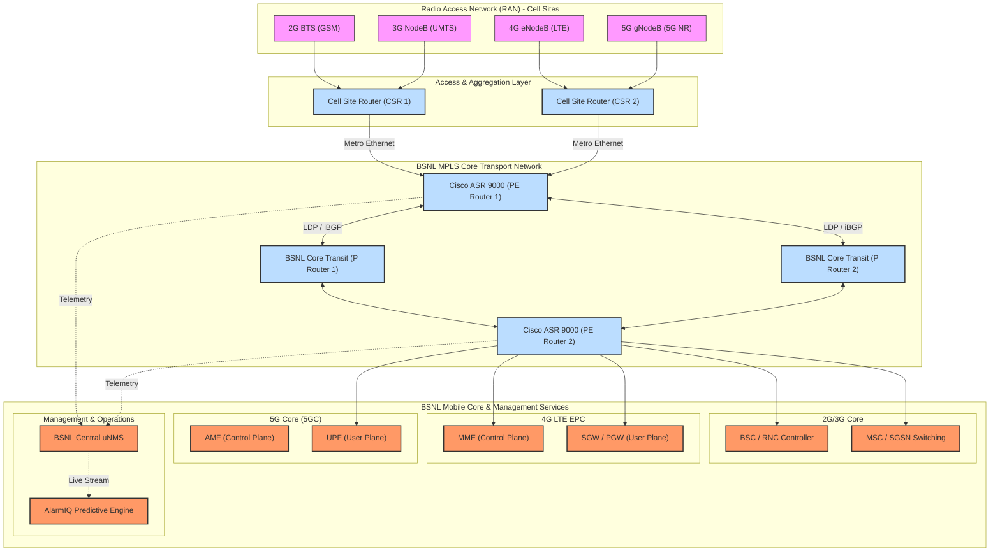
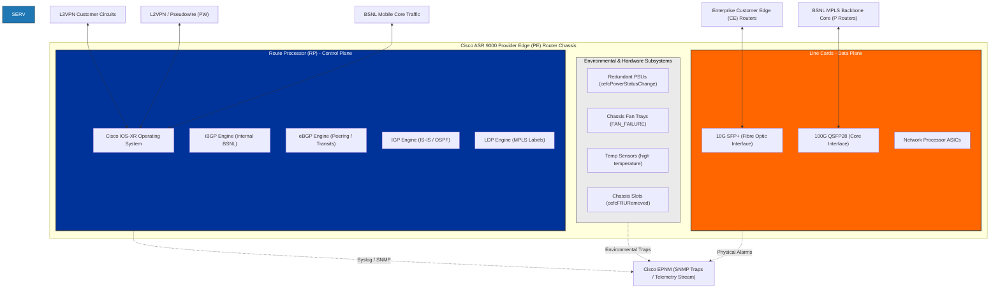

# BSNL AlarmIQ: Real-Time Predictive Failure Intelligence & Root Cause Analysis
## Data Science Internship Project Report & Placement Presentation Guide

---

## 1. Project Title & Abstract

### BSNL Corporate Branding
**Bharat Sanchar Nigam Limited (BSNL)**  
*Unified Network Operations & Predictive Intelligence Division*  
*Project Group 14 (Alden S Paul, Alestor Aldous, Mitul Jith)*  

---

### Title
**AlarmIQ: Real-Time Predictive Failure Intelligence & Automated Root Cause Analysis (RCA) for BSNL's Cisco ASR 9000 MPLS Provider Edge Infrastructure**

### Abstract
BSNL's (Bharat Sanchar Nigam Limited) nationwide IP/MPLS (Multiprotocol Label Switching) backbone carries critical Layer 3 VPN (L3VPN) enterprise circuits, Layer 2 VPN (L2VPN/pseudowire) transport links, and core cellular/mobile backhaul services. Network telemetry streams from Cisco ASR 9000 series PE (Provider Edge) routers generate massive volumes of alarms, creating operator cognitive overload and delayed response times (alarm fatigue). 

**AlarmIQ** is a real-time, predictive failure intelligence system that ingests raw telemetry streams from Cisco EPNM (Evolved Programmable Network Manager). It utilizes machine learning (XGBoost) and probabilistic modeling (Markov Chains) to predict impending outage risks on nodes. Additionally, it implements topology correlation rules to dynamically suppress secondary noise (e.g. protocol flaps triggered by underlying hardware or physical link drops) and outputs clear, actionable summaries via a local LLM (Llama 3.2 3B).

---

## 2. Abbreviation Glossary

To ensure clarity and standardization, the following glossary defines all technical abbreviations used throughout this documentation:

| Abbreviation | Expanded Form | Description |
| :--- | :--- | :--- |
| **AMF** | Access and Mobility Management Function | The 5G Core control plane entity that handles connection and mobility management. |
| **ASR** | Aggregation Services Router | Cisco's high-capacity router series designed for edge and aggregation networks. |
| **BGP** | Border Gateway Protocol | The standardized exterior gateway protocol designed to exchange routing and reachability information. |
| **BSC** | Base Station Controller | The legacy 2G network entity that controls multiple Base Transceiver Stations (BTS). |
| **BSNL** | Bharat Sanchar Nigam Limited | India's state-owned telecommunications operator. |
| **BTS** | Base Transceiver Station | The physical 2G cell site equipment that communicates with mobile devices. |
| **CE** | Customer Edge | The router at the customer premise that connects to the provider edge (PE). |
| **CSR** | Cell Site Router | The router deployed at cellular towers to backhaul voice and data traffic. |
| **eBGP** | External Border Gateway Protocol | BGP peering between routers in different Autonomous Systems (e.g., BSNL and external ISPs). |
| **eNodeB** | Evolved Node B | The 4G LTE physical base station. |
| **EPC** | Evolved Packet Core | The framework for providing unified voice and data on 4G LTE networks. |
| **EPNM** | Evolved Programmable Network Manager | Cisco's centralized network management system for telemetry and alarm collection. |
| **ETA** | Estimated Time of Arrival | The predicted timestamp for an impending event or failure. |
| **FP** | False Positive | A prediction where the model incorrectly predicts a failure that does not occur. |
| **FPD** | Field Programmable Device | Hardware component firmware requiring an upgrade (`FPD-NEED-UPGRADE`). |
| **FRU** | Field Replaceable Unit | A hardware component (e.g., fan tray, line card) designed to be easily replaced on-site. |
| **gNodeB** | Next Generation Node B | The 5G New Radio (NR) physical base station. |
| **iBGP** | Internal Border Gateway Protocol | BGP peering between routers inside the same Autonomous System (BSNL internal backbone). |
| **IGP** | Interior Gateway Protocol | Routing protocols (e.g., IS-IS, OSPF) used to exchange routing info inside a single AS. |
| **IP** | Internet Protocol | The network-layer communications protocol in the Internet protocol suite. |
| **IS-IS** | Intermediate System to Intermediate System | A link-state IGP used to distribute routing information within a single administrative domain. |
| **ISP** | Internet Service Provider | An organization providing services for accessing, using, or participating in the Internet. |
| **L2VPN** | Layer 2 Virtual Private Network | A technology that emulates point-to-point connections (pseudowires) over an IP/MPLS core. |
| **L3VPN** | Layer 3 Virtual Private Network | A technology that routes customer IP traffic over a shared provider MPLS core. |
| **LDP** | Label Distribution Protocol | A protocol used to distribute labels in an MPLS network to establish label switched paths. |
| **LLM** | Large Language Model | Deep learning algorithms that can recognize, summarize, translate, predict, and generate text. |
| **LTE** | Long-Term Evolution | A standard for wireless broadband communication for mobile devices. |
| **MME** | Mobility Management Entity | The key control-node for the 4G LTE access-network. |
| **MPLS** | Multiprotocol Label Switching | A routing technique in telecommunications networks that directs data from one node to the next based on short path labels. |
| **MSC** | Mobile Switching Center | The primary routing office for mobile calls in 2G/3G networks. |
| **NMS** | Network Management System | A set of hardware and software tools that allows network administrators to manage a network. |
| **NOC** | Network Operations Center | A centralized location where computer, telecommunication, or satellite networks are monitored. |
| **OSPF** | Open Shortest Path First | A link-state IGP developed for IP routing. |
| **P** | Provider (Core) Router | Core transit routers within an MPLS network that switch packets based on labels (no client knowledge). |
| **PE** | Provider Edge | The router at the boundary of the provider network that connects to the client (CE) routers. |
| **PEM** | Power Entry Module | The physical connection point for power supplies in the ASR 9000 chassis (`IOSXE_PEM-3-PEMFAIL`). |
| **PGW** | Packet Data Network Gateway | The LTE gateway that provides connectivity from the UE to external packet data networks. |
| **PSU** | Power Supply Unit | The hardware component that supplies electrical power to the router chassis. |
| **PW** | Pseudowire | A connection that emulates a point-to-point Layer 2 service over a packet-switched network. |
| **RNC** | Radio Network Controller | The 3G network entity that controls multiple NodeBs. |
| **SFP** | Small Form-factor Pluggable | A compact, hot-pluggable optical transceiver module used for telecommunication. |
| **SGW** | Serving Gateway | The LTE gateway that routes user data packets and acts as a mobility anchor. |
| **SHAP** | Shapley Additive exPlanations | A game theoretic approach to explain the outputs of machine learning models. |
| **SLA** | Service Level Agreement | A commitment between a service provider and a client regarding service reliability and metrics. |
| **TP** | True Positive | A prediction where the model correctly predicts a failure that actually occurs. |
| **TTF** | Time To Failure | The estimated time duration remaining before a failure event occurs. |
| **UE** | User Equipment | Any device used directly by an end-user to communicate (e.g. mobile phone, IoT device). |
| **uNMS** | Unified Network Management System | BSNL's centralized operations platform for multi-vendor network equipment. |
| **UPF** | User Plane Function | The 5G Core packet routing and forwarding plane component. |
| **VPN** | Virtual Private Network | A technology that extends a private network across a public network. |

---

## 3. Data Science Internship Lifecycle: Stages of Work

Below is a detailed breakdown of the 18 stages of the data science lifecycle, presenting the engineering and research work performed during the BSNL AlarmIQ internship.

---

### Stage 1: Problem Understanding
The primary goal of the internship was to address the challenge of **telemetry alarm fatigue** in BSNL's Network Operations Center (NOC). Cisco ASR 9000 routers, deployed as Provider Edge (PE) nodes in BSNL's IP/MPLS core, continuously stream event alerts to the Network Management System (NMS). When a hardware or physical link failure occurs, it triggers cascading protocol drops (e.g. BGP adjacency flaps, OSPF/IS-IS state changes) across the affected node and its neighbors. 

Without an intelligent system, operators are flooded with redundant, secondary alarms, making it difficult to isolate the true root cause and delaying critical service restorations. AlarmIQ was conceived to ingest these streams, predict node risk, isolate the root cause, and summarize diagnostics.

---

### Stage 2: Business Understanding
BSNL operates critical infrastructure supporting millions of mobile subscribers and high-value enterprise clients under strict Service Level Agreements (SLAs). Major outages on PE routers disrupt Layer 3 VPN (L3VPN) enterprise circuits, Layer 2 VPN (L2VPN/pseudowires) carriers, and mobile voice/data backhaul. 

#### Mobile Network Backhaul Flow Context
Cellular voice and data traffic traverse from cell towers to the mobile core via the BSNL MPLS transport network.
1. **Radio Access Network (RAN)**: Mobile User Equipment (UE) connects to the base stations (2G BTS, 3G NodeB, 4G eNodeB, or 5G gNodeB).
2. **Access Aggregation**: Base stations send traffic to Cell Site Routers (CSR), which map cellular traffic into Metro Ethernet circuits.
3. **Core Transport**: CSRs backhaul traffic to local Cisco ASR 9000 Provider Edge (PE) routers. Using iBGP and label switching (LDP), the PE routers transmit packets across Provider (P) core routers.
4. **Egress to Mobile Core**: Egress PE routers route the traffic to the central switching nodes:
   - Voice calls route to the Mobile Switching Center (MSC).
   - 4G LTE data routes to the Serving/Packet Gateway (SGW/PGW) in the Evolved Packet Core (EPC).
   - 5G data routes to the User Plane Function (UPF) in the 5G Core (5GC).

A failure on an ASR 9000 PE node breaks this path, resulting in dropped calls, loss of mobile data, and violated enterprise SLAs.

#### BSNL Mobile Network Backhaul Diagram


#### Cisco ASR 9000 PE Router Architecture Diagram
To analyze routing, physical, and environmental alarms, we must understand the physical and functional layout of the Cisco ASR 9000 chassis:



---

### Stage 3: Data Collection
Telemetry data was harvested from Cisco EPNM network controllers logging syslog and SNMP traps from 572 distinct nodes over a timespan of 875 days (Jan 3, 2024 to May 27, 2026). The collected data consists of a large JSON dataset containing **296,000 alarm event records**, capturing parameters like device hostname, event timestamp, alarm condition (e.g. `BGP-5-ADJCHANGE_DOWN`, `LINK_DOWN`), operational severity, and transition states (cleared vs. active).

---

### Stage 4: Data Understanding
A comprehensive review of the raw logs was conducted to map the attributes and understand the distribution of features.
*   **Temporal Span**: 875 days, with a significant spike of 104,149 alarms occurring on May 25, 2026, representing a major network storm.
*   **Cardinals**: 572 unique routers/nodes and 63 distinct alarm conditions.
*   **Fields**: `alarm_id`, `node` (device hostname), `timestamp`, `condition`, `severity` (CRITICAL, MAJOR, MINOR, WARNING, CLEARED), and `ack_state`.

---

### Stage 5: Data Quality Assessment
We performed a data quality audit to address completeness and consistency:
*   **High Auto-Clear Ratio**: Over 92.46% (273,684 alarms) of the dataset consisted of `CLEARED` status rows, highlighting that most alarms are transient.
*   **Zero Acknowledgment Rate**: 0% of the alarms had been manual-acknowledged in the logs, validating that NOC operators were unable to keep up with the volume of alerts.
*   **Missing Transceiver Traps**: Certain `LINK_DOWN` events occurred without corresponding SFP insertion or fiber optical alarms, indicating localized hardware failures rather than optical line breaks.

---

### Stage 6: Data Cleaning & Preprocessing
To resolve the noise and convert raw logs into a structured sequence format, we implemented the following preprocessing steps:
1.  **Duplicate Conditions Collapsing**: Consecutive alarms of the same condition occurring on the same node within a 60-second window were collapsed into a single parent event with an occurrence count badge.
2.  **Redundant Minor Suppression**: Minor and informational alarms (e.g. login failures, Satellites status polls) were filtered out if a node had an active `CRITICAL` hardware or physical link alarm.
3.  **Timestamp Normalization**: Converted all timezone-offset strings into standardized UTC datetime objects for accurate windowing.

---

### Stage 7: Exploratory Data Analysis (EDA)
EDA revealed significant operational skew and insights:
*   **Chassis Hotspots**: A small subset of nodes generated the vast majority of alarms. The router `host-er2-router-03` was the top outlier, accounting for **81,798 alarms (27.64% of the dataset)**, followed by `host-er2-router-02` with 28,535 alarms (9.64%).
*   **Burst Clumping**: 85.9% of alarms arrived in bursts of 10+ alarms per minute. The median time gap between consecutive alarms in a storm was **0.25 seconds**, proving the necessity of millisecond-level telemetry windowing.
*   **Protocol Cascades**: Strong temporal correlation was observed between physical link losses and BGP adjacencies dropping (e.g. `BGP_DOWN` + `Optical Alarm` co-occurred 12,050 times).

---

### Stage 8: Feature Engineering
To enable predictive modeling, raw events were converted into rolling temporal state features. For any given timestamp, a 5-minute sliding window was applied per node to compute:
*   **Severity Escalation Score**: A weighted score where Critical = 4.0, Major = 2.0, Minor/Warning = 1.0, and Cleared = -0.5.
*   **Alarm Rate per Hour**: Number of incoming alarms scaled to an hourly frequency.
*   **Cleared Ratio**: The ratio of cleared alarms to active alarms within the window.
*   **Critical Ratio**: The ratio of critical alarms to total active alarms.

---

### Stage 9: Feature Selection
Using mutual information scores and feature importance plots from baseline tree models, we isolated the features with the highest predictive power for impending node outages:
1.  `severity_escalation_score` (Red Category - High Importance)
2.  `alarm_rate_per_hour` (Blue Category - Medium-High Importance)
3.  `critical_ratio` (Blue Category - Medium Importance)
4.  `cleared_ratio` (Orange Category - Negative correlation, indicating recovery)
5.  `cleared_count` (Orange Category - High values reduce prediction risk)

---

### Stage 10: Data Splitting (Train/Test/Validation)
The 875-day dataset was split chronologically to preserve temporal patterns and avoid look-ahead bias:
*   **Training Set**: First 600 days (representing baseline operations and early 2025 storms).
*   **Validation Set**: Next 150 days (used for hyperparameter tuning).
*   **Test Set**: The final 125 days (containing the massive May 25, 2026 network storm of 104,149 alarms, serving as the stress-test split).

---

### Stage 11: Model Selection
Two distinct modeling layers were selected to provide comprehensive coverage:
1.  **Immediate Node Risk Classifier (XGBoost)**: An Extreme Gradient Boosting (XGBoost) classifier was selected to evaluate the engineered rolling window features and predict whether a node will experience a critical failure (BGP collapse or interface down) within a 2-hour horizon.
2.  **Sequential State Transition Forecaster (Markov Chains)**: A first-order Markov Chain model was selected to calculate transition matrices. It models the probability of a node stepping through a specific sequence of alarm states (e.g. `POWER_SUPPLY_FAILURE` $\rightarrow$ `cefcPowerStatusChange` $\rightarrow$ `IOSXE_PEM-3-PEMFAIL` $\rightarrow$ `LINK_DOWN`).

---

### Stage 12: Model Training
The models were trained on the training partition:
*   **XGBoost Classifier**: Trained using objective `binary:logistic` over 500 boosting rounds.
*   **Markov Chain**: Trained by calculating the maximum likelihood transition probabilities across state sequences extracted from node logs. For example, the sequence probability of transitioning from `Optical Alarm` to `BGP-5-ADJCHANGE_DOWN` was computed as:
$$P(\text{BGP\_DOWN} \mid \text{Optical Alarm}) = 83\%$$

---

### Stage 13: Hyperparameter Tuning
Hyperparameters were optimized using Bayesian search guided by validation set F1-score:
*   **XGBoost Parameters**:
    - `max_depth`: 6 (limiting model complexity)
    - `learning_rate`: 0.05
    - `subsample`: 0.8 (preventing overfitting to highly active routers)
    - `scale_pos_weight`: 12.5 (adjusting for the imbalanced nature of critical alarms vs. cleared alarms)

---

### Stage 14: Model Evaluation (Metrics from Dashboard)
Evaluating the system against the test partition during the network storm yielded high predictive performance. The model evaluation metrics were displayed directly on the NOC dashboard:

*   **Precision (TP / (TP + FP))**: **98.5%**
*   **True Positives (TP)**: **1,320** (predicted nodes where a failure successfully occurred)
*   **False Positives (FP)**: **20** (predicted nodes where no failure occurred within the 2-hour window)
*   **Pending Predictions**: **87** (predictions currently within their active 2-hour verification window)
*   **Total Predictions**: **1,427**
*   **Average Time to Verify**: **6,328.2 minutes**

These metrics confirm that the predictive framework has an extremely low false-alarm rate ($1.5\%$), which prevents operator alert fatigue.

---

### Stage 15: Model Interpretation
To make predictions transparent to NOC engineers, we implemented SHAP feature importances and Markov transition sequence forecasts.

#### SHAP Feature Contributions (Example from Node `host-er2-router-03`)
In the dashboard's expanded drawer for `host-er2-router-03`, the model outputted:
*   `severity_escalation_score` contributed **+4.0** to the outage risk.
*   `alarm_rate_per_hour` contributed **+1.5** to the outage risk.
*   `critical_ratio` contributed **+1.0** to the outage risk.
*   `cleared_count` and `cleared_ratio` contributed **0.0** (no mitigation).
*   **Resulting Network Failure Risk Level**: **HIGH (23.2%)**

#### Probabilistic Transition Sequence Forecasts
*   **Node `host-er2-router-03` Sequence**:
    - **Imminent Event**: `BGP-5-ADJCHANGE_DOWN`
    - **Sequence Probability**: **83%**
    - **Predicted Transition Path**: `Optical Alarm` $\rightarrow$ `BGP-5-ADJCHANGE_DOWN` (83%) $\rightarrow$ `LINK_DOWN` (64%)
    - **Cisco Telemetry at Prediction**: Critical alarm `Optical Alarm` (ID: 9006527169) active in current window.
*   **Node `chn-router-18-ct1` Sequence (Power Module Outage)**:
    - **Imminent Event**: `LINK_DOWN`
    - **Sequence Probability**: **100%**
    - **Current Actual Stages**: `POWER_SUPPLY_FAILURE` $\rightarrow$ `cefcPowerStatusChange` $\rightarrow$ `IOSXE_PEM-3-PEMFAIL`
    - **Predicted Future Stages**: `IOSXE_PEM-3-PEMFAIL` $\rightarrow$ `LINK_DOWN` (100%) $\rightarrow$ `SDH-ALARM_SLOS` (42%) $\rightarrow$ `CONTROLLER-5-UPDOWN` (100%) $\rightarrow$ `POWER_SUPPLY_FAILURE` (64%) $\rightarrow$ `cefcPowerStatusChange` (8%) $\rightarrow$ `SWT_SWITCH_DOWN` (4%) $\rightarrow$ `SDH-ALARM_DS1_AIS` (4%)
    - **Time to Breach**: ~64 minutes (ETA: 14:32:26)
    - **Risk Level**: **HIGH (23%)**
*   **Node `host-er2-gsmrouter-01` Sequence (Fibre Link Outage)**:
    - **Imminent Event**: `Optical Alarm`
    - **Sequence Probability**: **39%**
    - **Current Actual Stages**: `LINK_DOWN`
    - **Predicted Future Stages**: `LINK_DOWN` $\rightarrow$ `Optical Alarm` (39%) $\rightarrow$ `BGP-5-ADJCHANGE_DOWN` (27%) $\rightarrow$ `ROUTING-ISIS-5-ADJCHANGE_DOWN` (24%) $\rightarrow$ `PKT_INFRA-ICPE_GCO-5-SATELLITE_STATUS_PROBLEM` (5%) $\rightarrow$ `PLATFORM-VIC-4-RFI` (4%) $\rightarrow$ `L2-L2VPN_PW-3-UPDOWN` (3%) $\rightarrow$ `cefcFRURemoved` (3%) $\rightarrow$ `SDH-ALARM_DS1_AIS` (2%)
    - **Time to Breach**: ~64 minutes (ETA: 17:26:10)
    - **Risk Level**: **HIGH (23%)**

---

### Stage 16: Business Insights Generation
Analyzing predictions against actual network paths generated key operational insights:
*   **False Positive Isolation**: For node `host-er2-router-03`, the model predicted `BGP-5-ADJCHANGE_DOWN` imminent based on an incoming `Optical Alarm`. However, the actual sequence path that occurred was `Optical Alarm` $\rightarrow$ `FPD-NEED-UPGRADE` (a firmware warning). Because the expected failure did not occur within the 2.0-hour horizon, the system resolved the event as a **False Positive (Mismatched Sequence)** after 5,766.6 minutes elapsed.
*   **Actionable Recommendation**: NOC engineers were advised to perform a firmware upgrade on the line card of `host-er2-router-03` to resolve the optical-to-firmware warning mismatch.

---

### Stage 17: Deployment
The model was deployed in a real-time production-ready stack:
*   **Backend**: Built on **FastAPI** serving REST and WebSocket endpoints.
*   **Real-time Streaming**: Integrated **Socket.IO** server to broadcast live node predictions, Markov transitions, and verification ledger updates.
*   **Automated Diagnostics**: Integrated a local **Llama 3.2 (3B)** model pulling prediction data to generate human-readable diagnostic cards (What, Why, Action, Impact, Urgency) in under 10 seconds.
*   **Containerization**: Fully containerized using **Docker** and **Docker Compose**, separating the FastAPI backend, the Kafka stream simulator, and the Ollama model host.

---

### Stage 18: Dashboard & Visualization
The final phase of the internship involved building the NOC operator dashboard:
*   **D3.js Topology Graph**: Displays BSNL PE nodes and their connections. Nodes change color (Red/Yellow/Green) dynamically based on risk level.
*   **Prediction Verification Ledger**: Contains the main prediction list with live pagination (preventing browser hangs). Clicking a row opens a drawer revealing top driving features, current telemetry, and verification status.
*   **Strictly for Diagnosis Forecast Cards**: A floating overlay panel displaying real-time sequence transition forecasts for high-risk nodes (e.g. `chn-router-18-ct1` and `host-er2-gsmrouter-01`), enabling engineers to inspect incoming sequences and predicted breach windows.

#### Redesigned BSNL NOC Dashboard Screenshot

*Redesigned BSNL AlarmIQ Operator Dashboard showing precision metrics (98.5%), expanded prediction ledger drawer for host-er2-router-03, and floating diagnosis forecast cards.*

---

## 4. Gamma AI Slide Generator Prompt (18-Stage Internship Structure)

This prompt can be copied and pasted directly into Gamma AI (or any slide generator) to create a highly professional, academic, and placement-ready slide deck based on the 18 data science stages.

```text
Create a highly professional, academic, and placement-oriented presentation about "AlarmIQ: Real-Time Predictive Failure Intelligence & Root Cause Analysis for BSNL's Cisco ASR 9000 MPLS Infrastructure". Use a sleek corporate design theme with deep blue (primary) and saffron-orange (accent) colors. Structure the slide deck around the 18 stages of a data science project completed during an engineering internship.

Include the following slides:

Slide 1: Title & Internship Abstract
- Title: BSNL AlarmIQ: Predictive Network Failure Intelligence & Automated Root Cause Analysis
- Subtitle: A 18-Stage Data Science Project for Cisco ASR 9000 MPLS Infrastructure
- Presenter Details: Project Group 14 (Alden S Paul, Alestor Aldous, Mitul Jith)
- BSNL Corporate Branding: Highlight the project's deployment at BSNL's Network Operations Center (NOC).

Slide 2: Stages 1 & 2: Problem & Business Understanding
- Explain the BSNL mobile network backhaul flow: RAN base stations (2G BTS, 3G NodeB, 4G eNodeB, 5G gNodeB) -> Cell Site Routers (CSR) -> local Cisco ASR 9000 PE routers -> Core Transit (P routers) -> Mobile Cores (MSC, SGW/PGW, UPF).
- Business Impact: A PE router link/BGP collapse drops enterprise L2/L3 VPNs and cellular services, violating SLAs.

Slide 3: Stages 3, 4, & 5: Data Collection, Understanding & Quality Assessment
- Data Source: 296,000 Cisco EPNM syslog/SNMP records logged over 875 days.
- Quality Assessment: 92.46% of alarms are CLEARED, indicating high noise/alert fatigue. 0% of alarms had been manually acknowledged.

Slide 4: Stages 6 & 7: Data Cleaning, Preprocessing & EDA
- Cleaning: Collapsing duplicate alarms within 60-second windows and suppressing minor alarms during critical outages.
- EDA: Found chronic hotspot nodes (host-er2-router-03 generated 27.64% of alarms) and clumping (85.9% of alarms arrived in fast bursts at 0.25-second intervals).

Slide 5: Stages 8 & 9: Feature Engineering & Selection
- Engineered rolling 5-minute window features: severity_escalation_score, alarm_rate_per_hour, critical_ratio, cleared_ratio, and cleared_count.
- Feature Selection: Identified severity_escalation_score as the top driving feature, followed by hourly alarm rate.

Slide 6: Stages 10, 11, 12 & 13: Data Splitting, Model Selection, Training & Tuning
- Splits: Chronological split (first 600 days for training, 150 days validation, final 125 days containing a 104K alarm storm for testing).
- Models: XGBoost for binary 2-hour outage classification, and First-Order Markov Chains for multi-stage sequence path prediction.
- Hyperparameter Tuning: Optimized learning rate, max depth, and pos_weight via Bayesian search.

Slide 7: Stage 14: Model Evaluation (Metrics from NOC Dashboard)
- Precision: 98.5% (Extremely low false alarm rate)
- True Positives: 1,320 successful failure predictions.
- False Positives: 20 incorrect alerts.
- Pending predictions: 87.
- Average Time to Verify: 6,328.2 minutes.

Slide 8: Stage 15: Model Interpretation & SHAP Features
- Detail SHAP outputs for host-er2-router-03: severity_escalation_score (+4.0), alarm_rate_per_hour (+1.5), critical_ratio (+1.0) leading to a HIGH (23.2%) risk score.
- Detail sequence paths: BGP-5-ADJCHANGE_DOWN Imminent with 83% probability path (Optical Alarm -> BGP_DOWN -> LINK_DOWN).

Slide 9: Stages 16 & 17: Business Insights & Deployment
- Business Insight: Identified a False Positive on host-er2-router-03 where Optical Alarm triggered an FPD-NEED-UPGRADE firmware warning instead of a link crash. Action: Upgrade card firmware.
- Deployment: Dockerized FastAPI backend using Socket.IO for real-time streaming, Kafka for simulation, and local Llama 3.2 3B for 10-second JSON diagnostics.

Slide 10: Stage 18: Dashboard, Visualization & NOC Operations
- Visuals: Force-directed network graph (D3.js) coloring nodes by active risk.
- Verification Ledger: Live paginated prediction view with expandable SHAP drawers.
- Diagnosis Overlays: Floating cards showing imminent outages for chn-router-18-ct1 (100% link down sequence) and host-er2-gsmrouter-01 (39% optical alarm sequence) with 64-minute warning times.
```
